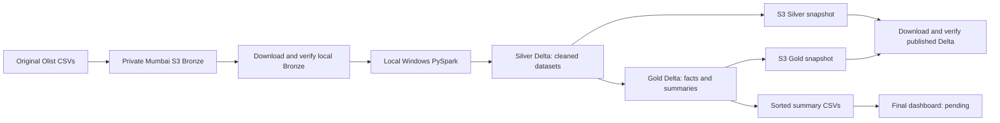

# RetailLake — detailed revision and troubleshooting guide

Updated: 12 October 2026 (Asia/Calcutta). This is the main study guide for the project so far.

## How to use this guide

The progress checklist tracks status; this guide explains what happened, why, how it was done, and the problems encountered. It reconstructs earlier work from the conversation, exported notebook, policy evidence, and saved results. It is not a complete transcript or a fresh audit of every historical AWS resource. Exact messages are included where available; unconfirmed causes and outcomes are labeled. No passwords, access keys, session tokens, or browser authorization URLs are included.

Evidence levels:

- **Verified:** inspected saved artifact or actual command result.
- **Historical:** recorded console/user output from earlier work, not newly audited.
- **User-reported:** an action or setting reported by the user.
- **Inference:** plausible explanation not conclusively demonstrated.
- **Pending:** unfinished or insufficiently confirmed work.

The [revision archive](history/2026-10-12_revision/README.md) preserves available code, logs, reports, and previous documents. Its [SHA256 inventory](history/2026-10-12_revision/archive_index.json) identifies the files. Use archived code copies when studying this milestone after the live scripts change. Some earlier logs were overwritten or existed only in conversation; this guide does not pretend that every original full log was retained.

## 1. Purpose and architecture

RetailLake is a retail analytics data lakehouse using three datasets from Olist Brazilian E-Commerce. It demonstrates source ingestion, integrity verification, data cleaning, analytical modeling, reconciliation, and publishing outputs.

**Active architecture: private AWS S3 storage + local Windows PySpark compute + Delta Lake tables.** Databricks Free Edition is a completed exploration prototype and optional reference.



| Component | Purpose |
| --- | --- |
| S3 | Durable source and publication storage |
| Python/PySpark | Language/API for Spark transformations |
| Java/JVM | Runs Spark's processing engine |
| Delta Lake | Parquet data plus transaction metadata defining each table |
| AWS CLI | Temporary authentication and file transfers |
| Antigravity | Local editor and terminal |
| Manifests/reports | Record inputs, hashes, schemas, counts, completion, and validation |

AWS is now used by the executed pipeline: Bronze came from S3; Silver/Gold were published back and downloaded again for verification. The first Databricks prototype used manually uploaded ZIP-derived files, so it had not established an S3-backed processing pipeline.

No Spark cluster, Glue/EMR job, cloud schedule, or AI service has been deployed. This is local compute with AWS storage.

## 2. Resources, versions, security, and costs

| Item | Recorded value |
| --- | --- |
| Active project folder | C:\Users\HP5CD\Desktop\Aaryav\RetailLake |
| Project account | 037315459859 |
| Management account used during policy troubleshooting | 209766594914 |
| Region | Mumbai, ap-south-1 |
| Bucket | retaillake-dev-037315459859-mumbai |
| Bronze prefix | bronze/olist/ |
| CLI profile/current role | retaillake / AccountFullAccessRole |
| Project environment | .venv; Python 3.13.15 reported by user |
| Pinned packages | pyspark==4.0.1; delta-spark==4.0.1; package metadata inspected |
| Java | Temurin OpenJDK 17.0.20.1 |
| JAVA_HOME | C:\Program Files\Eclipse Adoptium\jdk-17.0.20.101-hotspot\ |
| Bundled Hadoop | 3.4.1, identified from installed Spark JARs |
| Windows native Hadoop | tools/hadoop-3.4.1/bin/ |
| AWS CLI | 2.37.12, installed and used |
| Notebook backup | notebooks/RetailLake_01_Explore.ipynb, present and inspected |
| Runtime decision | Windows; WSL considered and deferred |

The user briefly reported Python 3.13.5, then corrected it to 3.13.15. AWS CLI's displayed Python 3.14.6 belongs to its bundled runtime, not our project environment.

The project began in the Codex Documents workspace, was copied into Desktop/Aaryav, then moved into its RetailLake subfolder. Older Documents copies are historical; the Desktop project is active. Other Aaryav projects were not moved.

Memory inspection through CIM was denied in the agent environment, so RAM capacity has not been confirmed. local[2] uses two processing threads; it is not a RAM measurement.

Security/cost status:

- At publication, all four bucket Block Public Access settings were unexpectedly false. They were restored to true and verified. The cause/time of the earlier change is unknown.
- Default and upload encryption use SSE-S3/AES256. HeadObject confirmed AES256 on the Gold completion manifest.
- No bucket policy exists, as observed during publication. This is not an encryption or upload failure.
- Historical checks recorded bucket-owner-enforced ownership/ACLs disabled, versioning off, Object Lock off, and website hosting off. Not all were re-audited during publication.
- User initially reported Free plan, $120 credits, 183 days remaining, $0 due. Later Paid-plan upgrade and advanced-feature activation were recorded. Initial credit/expiry values are not current figures.
- Budget: $5 monthly, actual-cost alerts above $1/$2/$5, alert email verified historically. A budget is an alert, not a hard cap.
- Storage, PUT/LIST/HEAD/GET requests, and downloads can incur charges. No new AWS compute was launched.
- Current authentication is temporary but administrative. Dedicated least-privilege pipeline access, current billing/credits, and Free Tier notifications remain to be reviewed.

## 3. Source data, keys, and baseline

| CSV | Data rows, excluding header | Bytes | CRC64NVME, base64 |
| --- | ---: | ---: | --- |
| olist_orders_dataset.csv | 99,441 | 17,654,914 | LQkjziOObt0= |
| olist_order_items_dataset.csv | 112,650 | 15,438,671 | EbgYRwtQD7c= |
| olist_products_dataset.csv | 32,951 | 2,379,446 | PUUAxjGU1iI= |

| Dataset | One row represents | Key | References |
| --- | --- | --- | --- |
| Orders | One order | order_id | customer_id retained; customer dataset not included |
| Items | One item within an order | order_id + order_item_id | order_id and product_id |
| Products | One product | product_id | Category and descriptive attributes |

An order can have multiple items. order_item_id is an item sequence number within the order, not a quantity field. items_sold counts item rows.

Known findings:

- Required dataset keys were unique and nonmissing in recorded checks.
- All items reference existing orders/products; local Silver/Gold found zero unmatched references/joins.
- 775 orders have no items. Preserve them in Orders; item facts cannot represent those orders.
- 610 products have no category. Preserve nulls in Silver; show Unknown in Gold.
- Optional timestamp nulls can be valid source omissions. They differ from a nonblank value failing conversion.

The user initially reported spreadsheet counts 99,442 / 112,651 / 32,952. Excluding the header gives the data counts above, later confirmed by CSV parsing and Spark. The [initial quality report](../data/bronze/olist/data_quality_report.txt) records no-item order statuses.

A matching sales sum is a check of one defined metric, not proof that every business measure is correct. This project uses a subset of the full Olist dataset.

## 4. Bronze ingestion and checksums

Original source CSVs were uploaded to bronze/olist/ with ingestion_manifest.json and data_quality_report.txt. Later, the authenticated laptop downloaded all five files directly from S3 into data/bronze/olist/.

```powershell
aws s3 ls s3://retaillake-dev-037315459859-mumbai/bronze/olist/ --profile retaillake --region ap-south-1
```

The zero-byte listing entry is a folder marker, not a dataset. [download_bronze.ps1](../scripts/download_bronze.ps1) verifies the account, downloads the selected files, and invokes [verify_bronze.py](../scripts/verify_bronze.py).

A checksum is calculated from file bytes. Equal row counts cannot detect changed values, dates, or ordering. Byte size, checksum, and record count give complementary evidence.

CRC64NVME is the manifest's algorithm; FULL_OBJECT represents the entire object rather than a multipart composite. Base64 encodes the checksum bytes; it is not a password or the data itself.

The actual verifier builds a CRC lookup table, reads bytes in 1 MiB chunks, updates the CRC byte by byte, applies the final XOR, and encodes the 8-byte value as base64. It separately counts parsed CSV records, excluding the header. It does not merely inspect file properties or assume the checksum from the console.

```python
passed = (
    size == entry['size_bytes']
    and rows == entry['data_rows']
    and checksum == entry['checksum_base64']
)
```

Every downloaded CSV matched the manifest. Evidence: [bronze_verification.json](../outputs/bronze_verification.json). This establishes equality with the recorded manifest, not independent authentication of the original publisher.

## 5. Databricks prototype and persistence

Created schema workspace.retaillake, volume workspace.retaillake.raw_files, and notebook RetailLake_01_Explore. Manually uploaded CSVs were read as strings, inspected, cast, validated, joined, filtered, and summarized. The item join retained 112,650 rows; sales totals reconciled to 13,221,498.11. Category/monthly Delta tables and a monthly chart were produced.

Examples from the exported notebook:

```python
items_typed = items.withColumn('price', F.col('price').cast('decimal(12,2)'))
orders_typed = orders.withColumn(
    'order_purchase_timestamp',
    F.to_timestamp('order_purchase_timestamp', 'yyyy-MM-dd HH:mm:ss')
)
```

```python
sales_items = (
    items_typed
    .join(orders_typed.select('order_id', 'order_status', 'order_purchase_timestamp'), 'order_id', 'left')
    .join(products.select('product_id', 'product_category_name'), 'product_id', 'left')
)
```

Python variables and temporary views can disappear when compute/session state ends. Persistent uploaded files and Delta tables are separate from memory. Rerunning preceding cells recreates DataFrames.

The inspected notebook backup is not guaranteed rerunnable:

- Cell 15 uses CREATE TABLE IF NOT EXISTS for category_sales. It avoids an existence error but does not refresh an old table when inputs change.
- Cell 19 still has plain CREATE TABLE for monthly_sales, which can fail if the table already exists.
- display(...) and /Volumes/... are Databricks conveniences; local scripts use filesystem paths and exports.
- The category display sorts descending, but its saved chart configuration was not freshly verified.

We did not rewrite the export to hide these limitations. The local scripts implement complete run snapshots. An .ipynb export does not back up CSV volume contents or Delta table storage. The Databricks resources have not been deleted.

## 6. Local Silver: typed, reusable datasets

Code: [build_silver.py](../scripts/build_silver.py). Detailed stage instructions: [SILVER_README.md](../scripts/SILVER_README.md).

The script re-verifies Bronze, creates a unique run directory, starts Delta-enabled Spark, reads explicit CSV schemas, trims whitespace, turns blanks into nulls, casts fields, checks conversions/required fields/keys/references, writes Delta, and reads each table back. It writes completion_manifest.json and silver_latest.json only after all checks pass.

| Fields | Silver type |
| --- | --- |
| Order timestamps and item shipping_limit_date | timestamp_ntz |
| order_item_id and product measurements/counts | integer |
| price and freight_value | decimal(12,2) |
| IDs, statuses, source category | string |

```python
converted = F.expr('try_cast(`price` AS decimal(12,2))')
```

A nonblank value that becomes null is counted as a conversion failure and stops the stage. Optional source nulls are preserved. Required fields differ by dataset: purchase timestamp is required, optional delivery timestamps are not, and product_id is required while product measurements/category may be null.

Decimals preserve fixed precision for money. IDs stay strings. Timestamp NTZ preserves source wall-clock values without assigning a timezone; source dates were not converted to UTC or India time. Run timestamps are separately recorded in UTC. Silver retains the source misspellings product_name_lenght/product_description_lenght.

Completed run: 20261011T184927Z_eb5aca1b. Orders 99,441; items 112,650; products 32,951. Required-field, conversion, key, reference, and readback checks passed. Findings: 775 no-item orders and 610 products missing categories.

An earlier failed run, 20261011T184745Z_be4fbf90, is not complete and was not used for Gold or publication. Its failure report is archived.

## 7. Gold tables and metric definitions

Code: [build_gold.py](../scripts/build_gold.py). Definitions: [GOLD_README.md](../scripts/GOLD_README.md).

| Table | One row represents | Rows |
| --- | --- | ---: |
| product_dim | One product | 32,951 |
| item_facts | One order item | 112,650 |
| category_sales | One reporting category | 74 |
| monthly_sales | One purchase month with activity | 23 |

A fact records business events/measures; a dimension describes entities. Item facts use order_id + order_item_id; products use product_id. No surrogate keys or slowly changing dimensions have been implemented.

```python
facts = items.join(orders, 'order_id', 'left')
facts = facts.join(product_dim.select('product_id', 'category'), 'product_id', 'left')
```

Left joins retain item rows so missing references can be detected. Unique source keys prevent row multiplication. Checks confirmed 112,650 rows, no duplicate fact keys, and no missing expected joined values.

```python
product_dim = products.withColumn(
    'category', F.coalesce(F.col('product_category_name'), F.lit('Unknown'))
)
facts = facts.withColumn('purchase_month', F.date_format('order_purchase_timestamp', 'yyyy-MM'))
delivered = facts.filter(F.col('is_delivered'))
```

All statuses remain in facts. Sales summaries include only delivered orders. Gold corrects the two product length column spellings; Silver remains unchanged.

```python
category_sales = delivered.groupBy('category').agg(
    F.count('*').alias('items_sold'),
    F.countDistinct('order_id').alias('orders'),
    F.sum('price').alias('item_sales')
)
```

Monthly sales use the same measures grouped by purchase_month.

- Sales: delivered-item price excluding freight; project currency label BRL, with no conversion.
- This is not verified profit, net revenue, payment collection, or order value including shipping. Payment/refund/cost data is not included.
- Delivered items: 110,197; distinct delivered orders with items: 96,478.
- Category order counts are not additive: one order can have multiple categories.
- Monthly distinct orders reconcile to overall delivered orders because each order has one purchase month.
- Missing calendar months are not filled with zero. The 23 rows represent months with activity.
- Delta tables do not promise display order; use orderBy. Exported category CSV sorts sales descending; monthly CSV sorts month ascending.

Fact, category, monthly, and Databricks-baseline sales all equal **13,221,498.11**. Summary item counts and monthly order counts also reconcile. All four tables were read back; saved summary rows were compared in both directions, and saved fact sales were checked.

Gold run: 20261011T185542Z_b894d4ac. Evidence: [gold_latest.json](../outputs/gold_latest.json).

## 8. S3 publication and verification

Code: [publish_snapshots.py](../scripts/publish_snapshots.py), [verify_published.py](../scripts/verify_published.py). Operating instructions: [PUBLICATION_README.md](../scripts/PUBLICATION_README.md).

| Snapshot | S3 prefix | Objects | Bytes, including manifest |
| --- | --- | ---: | ---: |
| Silver | silver/runs/20261011T184927Z_eb5aca1b/ | 9 | 17,235,499 |
| Gold | gold/runs/20261011T185542Z_b894d4ac/ | 14 | 14,404,995 |
| Total | Existing Mumbai bucket | 23 | 31,640,494 |

Delta includes Parquet files and _delta_log transaction metadata. Copying only Parquet would lose the Delta table definition. Local Hadoop .crc sidecars were excluded; they are filesystem checksums, not Delta transactions.

The publisher checks account/security/source completion, inventories files and SHA256, uploads with SSE-S3 and conditional writes, then uploads completion_manifest.json last. On resume, existing objects must match size/SHA256/encryption; unexpected or different objects stop publication.

```text
--if-none-match * --server-side-encryption AES256
```

This prevents replacement by our publisher, not by every authorized tool. It is not Object Lock. We publish inactive completed directories with one writer; concurrent writes/direct Spark S3 output are not implemented. A completion manifest is the consumer's completion signal; publishing multiple objects is not one atomic transaction.

Both snapshots were downloaded to fresh local directories. The full inventories, byte sizes, and SHA256 values matched. Spark read all seven downloaded Delta tables; counts and schemas matched. Fact/category/monthly totals stayed 13,221,498.11. Gold's source Silver ID matched the published Silver run.

Evidence: [publication_latest.json](../outputs/publication_latest.json). All four Block Public Access settings were restored to true before uploading. No AWS compute was launched.

Local latest JSON files point to completed local runs. No mutable S3 latest pointer exists. New full runs create new physical copies; batch-level idempotency/retention remain pending.

## 9. Timeline and decisions

| Phase | Work/decision | Outcome |
| --- | --- | --- |
| AWS setup | Account sign-in, credits, admin role, budget and email | $5 alerts; initial billing figures are historical |
| Region/storage | Sydney initially shown; advanced setup and organization Mumbai allowance | Private Mumbai bucket created |
| Ingestion | Corrected folder placement, original files, counts, checksums | Bronze manifest and quality report |
| Databricks | Manual uploads, typing, joins, delivered sales, charts | Prototype baseline and notebook backup |
| Session/reruns | Variables expired; tables already existed | Learned memory versus persistent storage |
| Databricks S3 | Delegation/manual credential and location attempts | No successful private S3 read confirmed |
| Policies | Scoped SCP exception saved; outside-org RCP deny found | SCP did not fix initial AssumeRole; RCP draft unsaved |
| Local route | Python/Java/venv/CLI setup | Windows runtime and temporary AWS profile |
| Local errors | Hostname, Hadoop components, sandbox permissions | Working Silver after fixes |
| WSL discussion | User considered WSL while retry ran | Windows retry completed; user chose Windows |
| Gold/publication | Facts/summaries, conditional S3 upload and readback | Seven tables verified; sales baseline unchanged |

Run IDs and JSON timestamps use UTC. For example, 11 October 19:08 UTC is 12 October approximately 00:38 in Asia/Calcutta, explaining the different dates.

Databricks branch resources: RetailLakeDatabricksBronzeReadRole, inline RetailLakeBronzeReadOnly, and read-only credential retaillake_bronze_read. Trust/self-trust/external ID were configured. Detailed policy/screenshots: [Connection_Plan.md](../databricks-s3/Connection_Plan.md).

The SCP exception in p-92jp4665 was saved with approval for the dedicated role's Oregon self-assumption; invalid builderid:* was removed. Validation still failed. RCP p-027sbkih2r denies non-service outside-organization principals and includes sts:*; it is a strong blocker candidate, not a conclusively verified root cause. Its specific exception was drafted but never saved. CloudTrail did not reveal the denial; absence of an event did not prove no request.

Free Edition incompatibility and a region mismatch were suggested but not established. Local compute was the user's selected working route. The RCP draft must not be applied for it.

Cleanup pending: unused delegation requests/credential/role, possible file-event resources after failed teardown, cancel/confirm unsaved RCP state, and review reversing only the saved Databricks SCP exception while preserving Mumbai. The original SCP JSON includes invalid builderid:*, so do not blindly restore it. No cleanup is implied by updating documents.

## 10. Challenges, errors, fixes, and unresolved issues

### AWS, data, and Databricks

| Issue | Response / lesson | Status |
| --- | --- | --- |
| Account sign-in information does not exist | Initial account/IAM sign-in confusion; later project login succeeded | Historical; not current |
| Missing notifications-contacts CreateEmailContact/SendActivationCode/ListEmailContacts | Admin label alone does not establish effective permission | Email later verified; full remediation chain not preserved |
| Sydney/fixed region and Mumbai creation error | Project setup and organization controls required attention | Mumbai created; original full creation error unavailable |
| Folder created outside bronze | Corrected prefix to bronze/olist/ | Resolved |
| Counts one larger in Excel | Exclude header | Confirmed later by parsing/Spark |
| Dates reformatted to day-month-year and minutes | Reloaded original ISO timestamps with seconds | Corrected; raw byte verification passed |
| Extracted products differed from ZIP original | Detected integrity difference; precise editing cause unknown | Used original source |
| Notebook session variables disappeared | Rerun upstream cells; distinguish memory from saved tables | Explained |
| UNSUPPORTED_OPERATION: errorifexists is not supported | Prototype moved to SQL creation | Local path writes work; environments differ |
| TABLE_OR_VIEW_ALREADY_EXISTS | Existing table conflicts on rerun | Export cell 19 still has plain CREATE TABLE; not silently fixed |
| DataFrame[num_affected_rows: bigint, num_inserted_rows: bigint] | Result description is not an error by itself | Tables read back to establish success |
| Chart Sort by option absent | Sort displayed DataFrame; final chart configuration not verified | Dashboard pending |
| PERMISSION_DENIED: Failed to get credentials; Assume Role failed | Investigated trust and organization policies | Unresolved, paused |
| Read/File Events Provision/Teardown failed | Stopped before Force create | No location/read confirmed; cleanup uncertain |
| Block Public Access flags false | Restored all four true and verified | Resolved at publication; cause unknown |
| NoSuchBucketPolicy | API found no bucket policy | Current state, not upload failure |

### Local runtime

**AWS CLI not found:** `aws : The term 'aws' is not recognized...`. Installed CLI and restarted terminal. Agent's stale PATH required the absolute user-install path. CLI Python version is separate from venv.

**Hostname error:** `Invalid Spark URL: spark://HeartbeatReceiver@Aaryav_Laptop:63076`. Underscore in the computer hostname caused internal URI parsing failure. Set SPARK_LOCAL_IP, spark.driver.host, and spark.driver.bindAddress to 127.0.0.1. The next range program displayed 0–4. Original full user output is archived.

**Missing Windows Hadoop:** `Did not find winutils.exe` and `HADOOP_HOME and hadoop.home.dir are unset`. Simple Spark range had worked, but Delta-enabled startup/file permission operations needed native components. Matched installed Hadoop 3.4.1 and Java 17, downloaded a community build, and verified its release SHA256. Stored it inside tools/; configured environment for script processes only. No System32 DLL copy or system environment change.

Source: [community release](https://github.com/zehelh/winutils/releases/tag/hadoop-3.4.1). SHA256: aa8098a433e6d63b865074468aa2da1aa9329ef33c9e9af799037f382ce50b82. Matching a published digest identifies the release artifact; it is not an independent security audit. These are not Apache-distributed Windows binaries.

**Sandbox temporary files:** PermissionError while creating/removing a temporary file under sandbox Temp. Used project .cache/tmp for TEMP, TMP, and tempfile.tempdir.

**Sandbox Delta readback:** `java.nio.file.AccessDeniedException: ...orders\_delta_log: Permission denied`. First run did not complete. Retried the authorized pipeline in normal Windows outside the sandbox; all Silver writes/readbacks passed. Failed run report archived and never used for Gold.

**Publisher executable fallback:** `FileNotFoundError: [WinError 2]`. LOCALAPPDATA referenced the sandbox rather than the real user installation. Changed fallback to Path.home()/AppData/Local/Programs/Amazon/AWSCLIV2/aws.exe. No upload at that failure point.

**Login-cache access:** CLI refresh encountered Permission denied on the existing temporary login cache. Granted narrow filesystem access. No cache credentials displayed/copied; this was not S3 IAM denial.

**Interrupted publication:** `[WinError 5] Access is denied: ...AWSCLIV2\awscli\botocore\data\rds`. This was CLI package loading, not an RDS API call. Silver was published and Gold partial. Added checksum-verified resume and reran outside sandbox. Existing files were not replaced. Both snapshots later passed verification. Full initial log was overwritten; this known excerpt is retained.

**Termination messages:** `SUCCESS: The process with PID ... has been terminated.` These prove process termination, not pipeline success. Actual result reports/readbacks establish success.

**Shutdown cleanup remains:** `ERROR ShutdownHookManager: Exception while deleting Spark temp dir`. Successful Silver/Gold/readback runs logged temporary JAR cleanup errors after verification and returned exit code 0. Data is verified, but output is not error-free. Probable cause: Windows file handles still open during deletion; a complete cleanup fix is not verified. Do not delete cache while Spark runs.

Other messages: incubator vector warning and SparkStringUtils plan-string truncation did not stop successful runs. Some agent Python commands printed `Failed to find real location of ...Python313\python.exe` but completed; exact launcher cause not diagnosed. Memory CIM query was denied; memory amount unconfirmed.

**Documentation-only error:** A long command writing this guide hit Windows CreateProcess error 206. It was split into smaller writes. This did not run or damage the pipeline/S3 data.

## 11. Runbook and rerun behavior

Run in Antigravity's terminal from the active folder:

```powershell
cd "C:\Users\HP5CD\Desktop\Aaryav\RetailLake"
.\.venv\Scripts\Activate.ps1
```

Activation selects the project Python for that terminal session. Without activation use .\.venv\Scripts\python.exe. Select that interpreter in the editor too. Do not reinstall packages simply because a terminal closed.

Fresh-machine setup checks:

```powershell
python --version
java --version
$env:JAVA_HOME
aws --version
python -m venv .venv
.\.venv\Scripts\python.exe -m pip install -r requirements.txt
```

requirements.txt covers Python packages, not Java, AWS CLI, or native Hadoop. Delta downloads extra Java dependencies from Maven Central on the first configured run. Linux can reuse transformations, but requires its own environment and paths; Windows venv cannot be reused as a Linux venv.

Temporary authentication:

```powershell
aws login --profile retaillake --region ap-south-1
aws sts get-caller-identity --profile retaillake --region ap-south-1
```

Select account 037315459859. Expiration can require login again. Do not share passwords/codes/credential cache. AWS skills installed; automatic MCP setup reported Gemini CLI configured, Codex skipped because codex was not on PATH. That did not prevent CLI processing and is not proof of an AWS MCP connection in this chat.

Pipeline order:

```powershell
.\scripts\download_bronze.ps1
python scripts\build_silver.py
python scripts\build_gold.py
python scripts\publish_snapshots.py
python scripts\verify_published.py
```

Optional standalone raw verification: `python scripts\verify_bronze.py`. Silver also runs it. These are operating instructions, not commands rerun just to create this guide.

Reruns currently replace local Bronze staging, create new Silver/Gold run directories, update local latest pointers only on success, and conditionally resume S3 uploads after checking existing files. Log filenames are overwritten. A complete second end-to-end rerun/same-batch idempotency milestone remains pending. Separate snapshots avoid modifying old tables but can create multiple physical copies of the same batch. No ingestion ledger, incremental MERGE, schedule, or retention policy yet.

## 12. File map, remaining work, and revision questions

| Location | Purpose |
| --- | --- |
| README.md | Entry point |
| RetailLake_Progress_Checklist.md | Status tracker |
| Local_PySpark_Plan.md | Active plan |
| notebooks/ | Databricks prototype backup |
| scripts/ | Actual code plus stage instructions |
| data/bronze/olist/ | Verified S3-downloaded raw files |
| data/silver/runs/ and data/gold/runs/ | Local snapshots; require completion manifests |
| data/published_verification/ | Downloads used for S3 readback |
| outputs/*_latest.json | Stage reports/pointers |
| outputs/*_run.log, published_readback.log | Current logs; overwritten on rerun |
| tools/hadoop_dependency.json | Binary source and checksum |
| databricks-s3/ | Screenshots, applied-policy evidence, unsaved drafts |
| docs/history/2026-10-12_revision/ | Frozen available evidence/code for this milestone |

Remaining required work: least-privilege pipeline role; ingestion ledger/incremental updates; full rerun/same-batch verification; retained per-run logs/timings; Windows temp cleanup; snapshot retention; Databricks resource/SCP cleanup; fresh billing/credits/Free Tier review; final dashboard and metric documentation. Label simulated incremental batches because this is static historical data.

AI question answering, late-delivery prediction, forecasting, direct Spark S3 access, scheduling, and paid AWS compute are optional future work, not implemented features.

Revision questions:

1. Why preserve Bronze and use checksum, size, and record-count checks together?
2. Why does Python Spark need Java, and why did range work before Delta startup did?
3. What are each table's grain/key and the consequences of duplicate join keys?
4. Why use decimals, timestamp_ntz, and separate null/conversion checks?
5. Why are category distinct-order counts not additive?
6. Why preserve Delta logs and publish a completion manifest last?
7. How did we verify S3 outputs rather than only local calculations?
8. Why can an administrator still be denied by an organization policy?
9. Which root causes were confirmed versus inferred?
10. How do snapshots differ from incremental/idempotent batch processing?

Project explanation: We built a private S3-backed retail pipeline with local Windows PySpark, verified three raw CSVs, produced three typed Silver Delta datasets and four Gold analytical tables, reconciled delivered-item sales to 13,221,498.11, and published/downloaded/verified complete snapshots. The Databricks prototype and failed integration attempts informed the design. Windows hostname/Hadoop/sandbox problems were addressed; shutdown cleanup and incremental/operational work remain.

## References and future documentation rule

Platform references consulted during implementation:

- [Spark installation](https://spark.apache.org/docs/4.0.1/api/python/getting_started/install.html) and [configuration](https://spark.apache.org/docs/4.0.1/configuration.html)
- [Delta compatibility](https://docs.delta.io/releases/) and [quick start](https://docs.delta.io/quick-start/)
- [Apache Hadoop Windows problems](https://cwiki.apache.org/confluence/display/HADOOP2/WindowsProblems)
- [AWS CLI temporary sign-in](https://docs.aws.amazon.com/cli/latest/userguide/cli-configure-sign-in.html)
- [S3 security](https://docs.aws.amazon.com/AmazonS3/latest/userguide/security-best-practices.html), [conditional PutObject](https://docs.aws.amazon.com/cli/latest/reference/s3api/put-object.html), and [pricing](https://aws.amazon.com/s3/pricing/)
- [Databricks Free Edition limits](https://docs.databricks.com/aws/en/getting-started/free-edition-limitations) and [manual S3 connection](https://docs.databricks.com/aws/en/connect/unity-catalog/cloud-storage/s3/s3-external-location-manual)
- [AWS RCP evaluation](https://docs.aws.amazon.com/organizations/latest/userguide/orgs_manage_policies_rcps_evaluation.html)

For future milestones record date, objective, commands/files changed, actual result, verification evidence, error excerpts, attempted fixes, confirmed/inferred cause, security/resource/cost changes, and pending cleanup. Archive logs before overwriting them. Update ticks only with supporting evidence. Retain failed attempts and changed decisions rather than presenting an unrealistically smooth history.

## Batch tracking milestone — 12 October 2026

User created and ran scripts/identify_batch.py, record_batch.py, and run_pipeline.py manually. Input batch SHA256 ID: ea23d41a00728ae8b14e7712bbc3b0f7305030bc26c6a7ce184c3e42ce002899. Bronze verification passed before completion was recorded in state/ingestion_ledger.json. Subsequent runner output was: Batch already completed. Processing skipped.

This verifies the completed-batch guard for the currently downloaded local inputs. It does not verify changed-batch processing, incremental updates, a full end-to-end second run, or automatic fresh S3 download. The current runner recalculates local fingerprints, checks the ledger, and skips before Silver/Gold/publication. Adding S3 refresh to the runner is next. Source/schema changes remain constrained by the current fixed baseline checks.

## Per-run logging completed — 12 October 2026

Updated scripts/run_pipeline.py to preserve a unique logs/<UTC timestamp>_<random suffix>.log and .json for each execution. The text log retains child commands, output, errors, and tracebacks. JSON records batch ID, started/finished UTC timestamps, total duration, per-step durations/exit codes, status, and error details where applicable. A running report is saved before processing and updated between steps. AWS CLI path discovery also supports a user-local install when the terminal's PATH is stale.

Executed run 20261011T193807Z_0ffded34: S3 refresh and Bronze checksum/size/row verification passed, fingerprint ea23d41a00728ae8b14e7712bbc3b0f7305030bc26c6a7ce184c3e42ce002899 matched the completed ledger entry, status was skipped, total duration 21.06 seconds, process exit code 0. No Silver/Gold rebuild or S3 output upload occurred. Logs: 20261011T193807Z_0ffded34.json and 20261011T193807Z_0ffded34.log in logs/.

This verifies retained logs/timings for the completed-batch skip path. New-batch completion, intentional failure reporting, crash recovery, concurrent-run protection, and a full second pipeline run have not been separately verified. Repeated runners still download S3 Bronze inputs before deciding to skip, so requests/downloads still apply. Current scripts remain single-writer; incremental processing is pending.

## Failure handling verified — 12 October 2026

Added `python scripts/run_pipeline.py --check-failure`. This opt-in branch runs a single local Python subprocess raising `RuntimeError: Intentional RetailLake failure check`, before any AWS download/fingerprint/Silver/Gold/publication/ledger stage. Default pipeline behavior remains the normal branch.

Executed run 20261011T194146Z_2b396279. Expected outcome occurred: child step failed with exit 1, runner recorded status failed and error/traceback, then exited 1. Only intentional_failure was recorded. The check itself passed; a failed runner status here is intentional, not a broken data pipeline.

Compared SHA256 inventories of all 117 existing files under data/, state/, and outputs/ before and after the check: unchanged, with no added/deleted files. No AWS step executed. Only logs/code/documentation/check evidence were written. Evidence: logs/failure_check_result.json, logs/20261011T194146Z_2b396279.json, and its .log. This checks subprocess failure propagation and logging; it does not prove recovery from crashes, interrupted uploads, concurrency, or every type of real AWS/Spark error. Incremental processing and full new-batch execution remain pending.

## Simulated incremental MERGE completed — 12 October 2026

Created and executed scripts/simulate_incremental.py separately from the main pipeline. Run 20261011T194436Z_83b87028 completed in 187.65 seconds. Source: verified Silver order_items. A deterministic composite-key sort seeded 110,650 rows, then a 2,015-row batch contained 2,000 held-out source rows simulating new arrivals, 10 synthetic price changes of +1.00, and 5 unchanged existing-row replays. This is a labeled local simulation, not real incremental retail activity or source corrections.

MERGE matched on order_id + order_item_id, updated matching rows only when non-key values differed using null-safe comparisons, inserted unmatched rows, and retained other target rows. Duplicate batch keys were rejected.

Verified first MERGE: 2,000 inserts, 10 updates, final 112,650 rows, zero duplicate keys, and full row-by-row equality against the expected simulated dataset. All-statuses item-price sum changed from 13,591,643.70 to 13,591,653.70 (synthetic +10.00). This is NOT the delivered-only Gold baseline of 13,221,498.11, which remained unchanged.

Replayed the exact batch through MERGE deliberately without using the main ledger skip. Verified zero inserts/updates and full equality of contents/counts/totals with version 1. Replay produced Delta version 2 and physically rewrote/copied 112,650 rows despite logical equality. Therefore data idempotency does not mean no I/O, no new transaction, or no runtime cost. The main batch ledger skip avoids that redundant work.

Compared before/after SHA256 inventories of 117 existing files under original Bronze/Silver/Gold/published-verification/state/outputs: unchanged. No AWS calls or S3 publication. Simulation artifacts reside only under data/simulations/incremental/20261011T194436Z_83b87028/ plus its report/log/documentation.

Evidence: outputs/incremental_simulation_latest.json, the run's simulation_report.json, retained logs/incremental_simulation_*.log, scripts/INCREMENTAL_README.md, and docs/history/2026-10-12_incremental/. The deterministic row_number window used one partition and logged a performance warning; suitable for this small demo, not a scalable partitioning strategy. Existing Windows temporary-JAR shutdown cleanup errors occurred after successful verification and exit 0.

This completes the isolated simulated key-based MERGE/replay milestone. It does NOT integrate changing source inputs into the main fixed-baseline full-snapshot pipeline. Real source batch semantics, correction ordering (older events must not overwrite newer corrections), multi-table dependencies, ledger transitions/recovery, Gold refresh, reconciliation baseline changes, publication, retention, deletions, schema changes, and concurrent writers remain separate work. The demo performs no deletions or schema evolution.

## Local dashboard created — 12 October 2026

Created dashboard/index.html, styles.css, app.js, data.js/data.json, and README.md, plus scripts/build_dashboard.py. It is an offline static dashboard with no external dependencies or cloud hosting. Includes delivered-item sales, distinct delivered orders with items, item count, sales per order, date/category filters, sales/orders/items trend, top category bars, searchable/sortable/paginated category table, selected-category CSV export, and metric/provenance notes.

Exporter read the actual verified Gold item_facts and checked all local artifacts against the published SHA256 manifest. It produced 23 monthly rows, 74 categories, and 1,273 category-month rows. Monthly/cube sales and item counts, monthly distinct order counts, and category cube totals match the Gold summaries. Baseline remains R$13,221,498.11, 96,478 delivered orders with items, and 110,197 items. No simulation data, AWS calls, S3 uploads, or compute deployment.

All-category order KPIs use monthly distinct counts; category counts are not summed across categories. Single-category counts can be summed across purchase months. Missing months are not filled with zeros. Currency is BRL; sales exclude freight and are not net revenue/profit. Data source and verification timestamp are shown in the notes.

A local preview attempt inside the sandbox could not be reached; restarted localhost-only outside the sandbox and confirmed HTTP 200. Codex browser handoff returned queued, not a confirmed visible page. The temporary preview was stopped after handoff; open the offline HTML directly. No browser interaction/visual tests were run. The exporter completed with the known post-run Windows temporary-JAR cleanup errors. These limitations are not presented as tested dashboard behavior.

Open from PowerShell: Start-Process .\dashboard\index.html. Rebuild data after a new verified publication with .\.venv\Scripts\python.exe scripts\build_dashboard.py. Keep dashboard assets together. Instructions and definitions are in dashboard/README.md. Real incremental integration, full pipeline rerun, operational cleanup/security/retention, and optional AWS Glue migration remain pending.

Dashboard default updated on 12 October 2026: initial load and Reset filters now select January 2017 through the latest available month (currently August 2018). Earlier 2016 months remain selectable; stored data and full-history baseline reports are unchanged. If January 2017 is absent in a future dataset, the default falls back to its first available month. Dashboard indicators now initially represent the selected 2017-onward period, not the full-history baseline.
